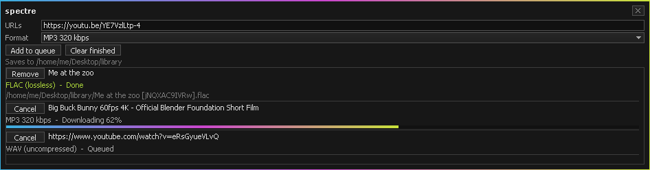

# spectre

**Paste YouTube links, get the best audio YouTube has.** spectre is a tiny native desktop app that turns YouTube videos into **MP3 320 kbps**, **FLAC** or **WAV** files in `~/Desktop/library`. Queue as many links as you like, watch them download, and cancel any of them. Every file is tagged with its title and artist.



## Why it's cool

**It's small.** The whole release is a ~760 KB download on Linux and ~700 KB on Windows. There's no Electron, no bundled browser and no Python runtime: one native executable with a GPU-drawn UI, written in about 370 lines of C++.

**It sits still when you're not using it.** The UI only redraws when something changes, like a key press, a click or a progress update from a download. Left alone it uses no measurable CPU: 0 seconds of CPU time over a 9-second idle test.

**It goes straight for the best audio.** spectre asks yt-dlp for the highest-quality audio stream YouTube has, then:

| Format | What you get |
|---|---|
| **FLAC** | That stream, exactly, losslessly compressed. The best choice for a library. |
| **WAV** | That stream, exactly, as uncompressed 16-bit PCM. For editors and samplers. |
| **MP3 320 kbps** | The highest bitrate MP3 allows, for players that need MP3. |

Be honest with yourself about the source: YouTube only serves lossy audio (Opus or AAC, usually 130–160 kbps). FLAC and WAV add no further loss, but no format can restore what YouTube already threw away.

**Cancel means cancel.** Stopping a job ends yt-dlp *and* the ffmpeg it started (a process group on Linux, a Job object on Windows). Partial downloads go to a per-job temporary folder that is always deleted, so a cancelled job leaves no `.part` files behind in your library.

**It's careful with what you paste.** Links are handed straight to yt-dlp as arguments, never through a shell, so a pasted link can't run commands or turn into a yt-dlp option. Only YouTube links are accepted, and playlists download just the one video you linked.

**One-line install, no admin rights.** On Linux the installer also offers to set up yt-dlp, ffmpeg and SDL3. On Windows it fetches yt-dlp and ffmpeg for you and adds a Start Menu shortcut. Both install for your user only and uninstall cleanly.

## Built with kitui

spectre's interface is built on **kitui**, my own immediate-mode UI library for C++20 (private for now). kitui is what makes spectre this small and this quiet:

- **Immediate mode.** There are no widget objects to create, wire up or keep in sync. Your data is the state, and each frame the UI is just function calls. spectre's whole queue view is a plain loop over the jobs:
  ```cpp
  if (kit::button(c, live ? "Cancel" : "Remove", c.px(56))) { /* ... */ }
  c.same_line();
  kit::text(c, it.title.empty() ? it.url : it.title);
  if (it.st == St::Running) kit::progress(c, it.pct);
  ```
- **Native GPU rendering everywhere.** OpenGL 3.3 through SDL3 on Linux and Direct3D 11 on Windows, plus Vulkan, Direct3D 12 and Direct3D 9 renderers for apps that run their own loop. It's HiDPI-aware, with the font atlas baked into the binary.
- **No third-party runtime dependencies in the core.** That's why the Windows build is a single `.exe` that needs nothing beyond Windows itself.
- **Sleeps while idle.** kitui only draws a frame after input or when the app asks for one. spectre's download thread calls `kit::wake()` on each progress update, and that's the only reason it ever redraws on its own.
- **The look.** The rainbow-edged frame, the gradient progress bars and the compact, crisp controls are all kitui's.

kitui also runs as an injectable in-game overlay on Windows. spectre is just one of the things it's built for.

## Install

**Linux (x86_64)**, needs glibc 2.38+ and SDL3 (Arch, Fedora 42+, Ubuntu 25.04+, Debian 13); the installer offers to install yt-dlp, ffmpeg and SDL3 if missing:
```sh
curl -fsSL https://raw.githubusercontent.com/333stack/spectre/main/install.sh | bash
```

**Windows 10/11 (x64)**, in PowerShell; downloads yt-dlp and ffmpeg if you don't have them:
```powershell
irm https://raw.githubusercontent.com/333stack/spectre/main/install.ps1 | iex
```

Uninstall: `./install.sh --uninstall` or `.\install.ps1 -Uninstall`.

Keep yt-dlp up to date, because YouTube changes often break old versions. On Linux, update it with your package manager. On Windows, if the installer downloaded it for you, run `& "$env:LOCALAPPDATA\Programs\spectre\yt-dlp.exe" -U`.

## Build

Release binaries don't need kitui. Building from source needs kitui (private, ask for access) checked out next to this folder (`../kitui`), CMake, Ninja, and SDL3 on Linux.
```sh
cmake -S . -B build -G Ninja -DCMAKE_BUILD_TYPE=Release && cmake --build build
scripts/package.sh   # release assets in dist/ (Linux tarball + Windows zip, cross-built with MinGW)
```

## License

Copyright 2026 Sandia. spectre and kitui are both my work. [PolyForm Noncommercial 1.0.0](LICENSE.md):

- You may use, modify and share spectre for any noncommercial purpose.
- You must always credit the author: keep the `Required Notice` line and the license with every copy, modified or not.
- Commercial use requires prior written permission. Contact [@333stack](https://github.com/333stack).

The bundled UI font is LGPL; see `NOTICE.txt` in each release. yt-dlp and ffmpeg are separate programs under their own licenses.
